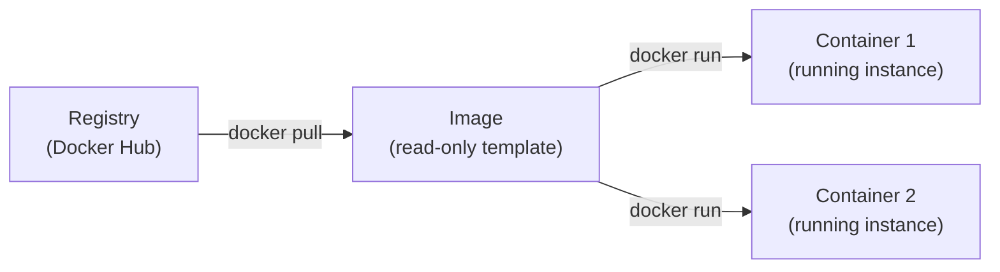

---
tags:
  - Privilege management
---

# Installation and concepts

## Prerequisites

- Linux host (tested on Ubuntu Server, no graphical mode), root or sudo access
- Basic Linux administration and virtualization knowledge
- An SSH client with copy/paste (MobaXterm or similar) makes typing commands easier

## Installation

Adding Docker's official repository, then installing the Community edition:

```bash
sudo apt update
sudo apt install -y apt-transport-https ca-certificates curl software-properties-common

# GPG key and Docker's official repository
curl -fsSL https://download.docker.com/linux/ubuntu/gpg \
  | sudo gpg --dearmor -o /usr/share/keyrings/docker-archive-keyring.gpg

echo "deb [arch=$(dpkg --print-architecture) \
  signed-by=/usr/share/keyrings/docker-archive-keyring.gpg] \
  https://download.docker.com/linux/ubuntu $(lsb_release -cs) stable" \
  | sudo tee /etc/apt/sources.list.d/docker.list > /dev/null

sudo apt update
apt-cache policy docker-ce    # confirms the version that will be installed
sudo apt install -y docker-ce

sudo systemctl enable --now docker
```

`apt-cache policy docker-ce` shows which version will be installed — worth checking before committing.
`systemctl enable --now docker` enables and starts the service in a single command.

### Post-installation check

```bash
docker version          # client and daemon versions
docker info             # overall state: containers, images, network and storage drivers
sudo docker run hello-world
```

### Running without sudo (optional)

To avoid prefixing every command with `sudo`:

```bash
sudo usermod -aG docker $USER
newgrp docker            # takes effect without logging out
```

!!! warning "Security risk"
    A user in the `docker` group has permissions equivalent to `root` on the host system. Reserve this for a development machine or a tightly controlled environment.

## Key concepts



| Term | Definition |
|---|---|
| **Image** | Immutable, layered template; the basis for one or more containers |
| **Container** | A running instance of an image; isolated by namespace and cgroup |
| **Registry** | A repository of images (Docker Hub by default, or a private registry) |
| **Volume** | Persistent storage decoupled from the container's lifecycle — see [Volumes and persistence](docker-volumes.md) |
| **Network** | Network isolation layer between containers — see [Docker networking](docker-reseau.md) |

Day-to-day commands (images, containers) continue in [Images and containers](docker-conteneurs.md).

## Verification

```bash
docker version
docker info
```

## Troubleshooting

| Symptom | Likely cause | Fix |
|---|---|---|
| `permission denied` on `/var/run/docker.sock` | User not in the `docker` group | `sudo usermod -aG docker $USER` then `newgrp docker` |
