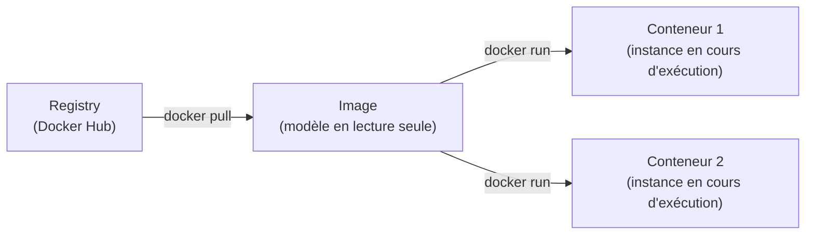

# Installation et concepts

## Prérequis

- Hôte Linux (testé sur Ubuntu Server, sans mode graphique), accès root ou sudo
- Notions de base d'administration Linux et de virtualisation
- Un client SSH avec copier/coller (MobaXterm ou équivalent) simplifie la saisie des commandes

## Installation

Ajout du dépôt officiel Docker puis installation de l'édition Community :

```bash
sudo apt update
sudo apt install -y apt-transport-https ca-certificates curl software-properties-common

# Clé GPG et dépôt officiel Docker
curl -fsSL https://download.docker.com/linux/ubuntu/gpg \
  | sudo gpg --dearmor -o /usr/share/keyrings/docker-archive-keyring.gpg

echo "deb [arch=$(dpkg --print-architecture) \
  signed-by=/usr/share/keyrings/docker-archive-keyring.gpg] \
  https://download.docker.com/linux/ubuntu $(lsb_release -cs) stable" \
  | sudo tee /etc/apt/sources.list.d/docker.list > /dev/null

sudo apt update
apt-cache policy docker-ce    # confirme la version disponible avant installation
sudo apt install -y docker-ce

sudo systemctl enable --now docker
```

`apt-cache policy docker-ce` affiche la version qui sera installée — à vérifier avant de valider.
`systemctl enable --now docker` active et démarre le service en une seule commande.

### Vérification post-installation

```bash
docker version          # versions du client et du démon
docker info             # état global : conteneurs, images, pilotes réseau et stockage
sudo docker run hello-world
```

### Droits sans sudo (optionnel)

Pour éviter de préfixer chaque commande par `sudo` :

```bash
sudo usermod -aG docker $USER
newgrp docker            # prend effet sans déconnexion
```

!!! warning "Risque de sécurité"
    Un utilisateur dans le groupe `docker` a des droits équivalents à `root` sur le système hôte. À ne faire que sur un poste de développement ou un environnement maîtrisé.

## Concepts clés



| Terme | Définition |
|---|---|
| **Image** | Modèle immuable en couches ; sert de base à un ou plusieurs conteneurs |
| **Conteneur** | Instance en cours d'exécution d'une image ; isolé par namespace et cgroup |
| **Registry** | Dépôt d'images (Docker Hub par défaut, ou registre privé) |
| **Volume** | Stockage persistant découplé du cycle de vie du conteneur — voir [Volumes et persistance](docker-volumes.md) |
| **Réseau** | Couche d'isolation réseau entre conteneurs — voir [Réseau Docker](docker-reseau.md) |

La suite des commandes quotidiennes (images, conteneurs) est dans [Images et conteneurs](docker-conteneurs.md).

## Vérification

```bash
docker version
docker info
```

## Dépannage

| Symptôme | Cause probable | Correction |
|---|---|---|
| `permission denied` sur `/var/run/docker.sock` | Utilisateur non dans le groupe `docker` | `sudo usermod -aG docker $USER` puis `newgrp docker` |
