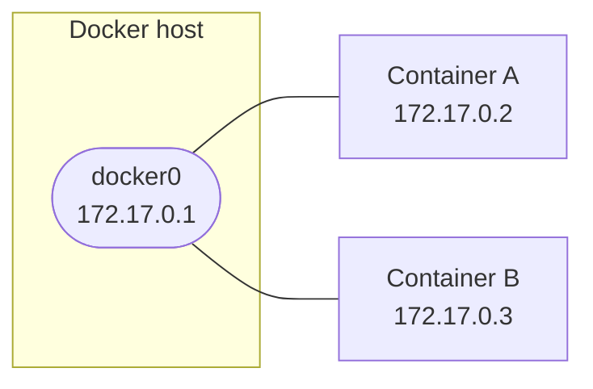

---
tags:
  - DNS
---

# Docker networking

## Default architecture

On install, Docker creates a `docker0` interface and a bridge network of the same name. Unless told otherwise at launch, every container attaches to it.



## Network commands

```bash
docker network ls                           # lists every network
docker network inspect <network>            # details: subnet, attached containers
docker network create <network>             # creates a custom bridge network
docker network create --driver bridge \
  --subnet 192.168.100.0/24 \
  --gateway 192.168.100.1 <network>         # with explicit parameters
docker network rm <network>                 # removes a network (must be empty)
docker network prune                        # removes every unused network

docker network connect <network> <container>     # attaches a container to a network
docker network disconnect <network> <container>  # detaches it
```

!!! tip "Prefer a custom bridge network"
    On the default `bridge` network, containers reach each other by IP. On a **named** bridge, Docker enables an internal DNS: containers reach each other directly by name (`--name`).

## Changing the docker0 network

If `172.17.0.0/16` conflicts with an existing addressing plan, create or edit `/etc/docker/daemon.json`:

```json
{
  "bip": "<ip-address>/24"
}
```

```bash
sudo systemctl daemon-reload
sudo service docker restart
ip a show docker0
```

!!! warning "Connectivity drops while it restarts"
    `service docker restart` briefly interrupts `docker0` and cuts networking for every running container while the daemon restarts. The containers themselves don't stop, but their network connections (Portainer included) only come back once the service is back up.

??? note "Rolling back to the default"
    Set `bip` back to its original value, restart, verify, then delete the file:
    ```json
    {
      "bip": "172.17.0.1/16"
    }
    ```
    ```bash
    sudo systemctl daemon-reload
    sudo service docker restart
    sudo rm -f /etc/docker/daemon.json
    ```

## Verification

```bash
docker network ls
docker network inspect bridge
ip a show docker0
```

## Troubleshooting

| Symptom | Likely cause | Fix |
|---|---|---|
| `/etc/docker/daemon.json` not found | File absent by default | Create it with the expected content, then `systemctl daemon-reload` and `service docker restart` |
| Changing `bip` has no effect on `docker0` | Service not reloaded after the change | `systemctl daemon-reload` then `service docker restart`, check with `ip a show docker0` |
