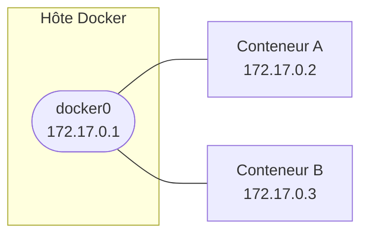

# Réseau Docker

## Architecture par défaut

À l'installation, Docker crée une interface `docker0` et un réseau bridge du même nom. Sans précision au lancement, tout conteneur y est rattaché.



## Commandes réseau

```bash
docker network ls                           # liste tous les réseaux
docker network inspect <réseau>             # détails : sous-réseau, conteneurs rattachés
docker network create <réseau>              # crée un réseau bridge personnalisé
docker network create --driver bridge \
  --subnet 192.168.100.0/24 \
  --gateway 192.168.100.1 <réseau>          # avec paramètres explicites
docker network rm <réseau>                  # supprime un réseau (doit être vide)
docker network prune                        # supprime tous les réseaux inutilisés

docker network connect <réseau> <conteneur>     # rattache un conteneur à un réseau
docker network disconnect <réseau> <conteneur>  # détache
```

!!! tip "Préférer un réseau bridge personnalisé"
    Sur le réseau `bridge` par défaut, les conteneurs se joignent par IP. Sur un bridge **nommé**, Docker active un DNS interne : les conteneurs se joignent directement par leur nom (`--name`).

## Modifier le réseau docker0

Si `172.17.0.0/16` entre en conflit avec un plan d'adressage existant, créer ou modifier `/etc/docker/daemon.json` :

```json
{
  "bip": "<adresse-ip>/24"
}
```

```bash
sudo systemctl daemon-reload
sudo service docker restart
ip a show docker0
```

!!! warning "Coupure de connectivité lors du redémarrage"
    `service docker restart` interrompt brièvement `docker0` et coupe la mise en réseau de tous les conteneurs en cours d'exécution pendant que le démon redémarre. Les conteneurs ne s'arrêtent pas, mais leurs connexions réseau (Portainer inclus) se rétablissent seulement une fois le service revenu.

??? note "Revenir à la valeur par défaut"
    Repasser `bip` à sa valeur d'origine, redémarrer, vérifier, puis supprimer le fichier :
    ```json
    {
      "bip": "172.17.0.1/16"
    }
    ```
    ```bash
    sudo systemctl daemon-reload
    sudo service docker restart
    sudo rm -f /etc/docker/daemon.json
    ```

## Vérification

```bash
docker network ls
docker network inspect bridge
ip a show docker0
```

## Dépannage

| Symptôme | Cause probable | Correction |
|---|---|---|
| `/etc/docker/daemon.json` introuvable | Fichier absent par défaut | Le créer avec le contenu attendu, puis `systemctl daemon-reload` et `service docker restart` |
| Changement de `bip` sans effet sur `docker0` | Service non rechargé après modification | `systemctl daemon-reload` puis `service docker restart`, vérifier avec `ip a show docker0` |
