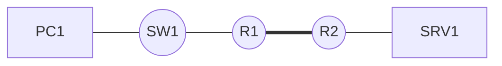
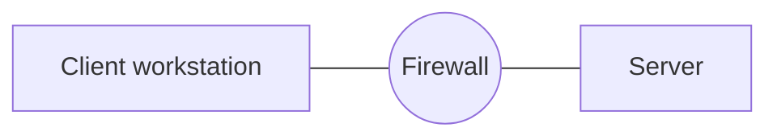

# Page template

Copy the block below to start a new procedure.

````markdown
# Procedure title

## Context

What the procedure achieves, and in which situation it applies.

## Prerequisites

- Hardware and software versions
- Required access and rights
- Configuration assumed already in place

## Topology



## Procedure

### 1. First step

```cisco
command
```

### 2. Second step

```cisco
command
```

## Rollback plan

How to undo this configuration if it needs to be removed.

```cisco
undo command
```

## Verification

```cisco
show ...
```

Expected result: describe what should appear.

## Troubleshooting

| Symptom | Likely cause | Fix |
|---|---|---|
| | | |
````

---

## Project template

A page combining several building blocks (a complete architecture rather than a single procedure) follows a different structure from the one above — copy the block below to start a new project page. A project page doesn't re-explain every building block in detail: it links to the corresponding unitary page when one exists, and focuses on what a unitary page can't show — why this architecture, in what order to build it, and above all where the building blocks touch each other.

````markdown
# Project title

## Business context

The need this architecture addresses, as a concrete situation — not a list of technologies.

## Overall architecture



One paragraph per zone of the diagram: what it contains, what separates it from the others.

## Components and each one's role

| Component | Role | Detailed page |
|---|---|---|
| | | |

## Deployment sequencing

1. Step, and why it must precede the next one.

## Critical integration points

What only works if the building blocks are correctly connected to each other: firewall rules that let a specific flow through, name resolution crossing a network boundary, return route, shared or deliberately separate authentication.

## End-to-end verification

A test that goes through the whole chain, not block by block.

## Global rollback plan

The order in which to disable each building block without breaking the others.
````
