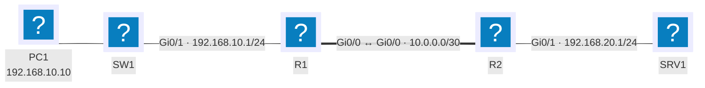
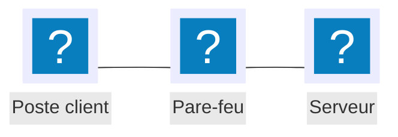

# Gabarit de fiche

Copier le bloc ci-dessous pour créer une nouvelle procédure. La structure est identique sur toutes les fiches du site — chaque section a un rôle précis.

---

## Rôle de chaque section

| Section | Contenu attendu |
|---|---|
| **Contexte** | Ce que la procédure permet de faire et dans quelle situation on l'applique |
| **Prérequis** | Matériel, versions, accès, configuration supposée déjà en place |
| **Topologie** | Diagramme Mermaid du scénario, avec adresses et noms d'interfaces |
| **Procédure** | Étapes numérotées, une opération par `###`, commandes dans des blocs de code |
| **Plan de retour arrière** | Comment défaire ce qui a été fait, dans le bon ordre |
| **Vérification** | Commande(s) qui prouvent que ça fonctionne + résultat attendu |
| **Dépannage** | Tableau symptôme → cause probable → correction |

---

## Gabarit à copier

````markdown
# Titre de la procédure

## Contexte

Ce que la procédure permet de faire, et dans quelle situation on l'applique.

## Prérequis

- Matériel et versions logicielles nécessaires
- Accès et droits requis (root, mode privilégié, SSH…)
- Configuration supposée déjà en place (lien vers une autre fiche si besoin)

## Topologie



## Procédure

### 1. Première étape

Description courte de ce que fait cette étape.

```cisco
commande
```

!!! tip "Indication utile"
    Explication d'un comportement non évident ou d'une option importante.

### 2. Deuxième étape

```cisco
commande
```

### 3. Enregistrer

```cisco
end
copy running-config startup-config
```

## Plan de retour arrière

Comment annuler cette configuration, dans quel ordre, et ce qu'il ne faut pas oublier.

```cisco
configure terminal
no <commande-à-annuler>
end
copy running-config startup-config
```

!!! warning "Dépendances à vérifier avant de retirer"
    Indiquer si d'autres configurations (ACL, NAT, autre protocole) dépendent de ce qui est retiré.

## Vérification

```cisco
show ...
```

Résultat attendu : décrire ce qui doit apparaître pour confirmer que la procédure a fonctionné.

## Dépannage

| Symptôme | Cause probable | Correction |
|---|---|---|
| Symptôme 1 | Cause 1 | Correction 1 |
| Symptôme 2 | Cause 2 | Correction 2 |
````

---

## Conventions de rédaction

Les [conventions d'écriture](conventions.md) détaillent les notations utilisées sur tout le site (adresses de référence, noms d'interfaces, valeurs génériques). À lire avant de créer une nouvelle fiche.

### Blocs de code

- `cisco` — commandes Cisco IOS
- `bash` — shell Linux
- `powershell` — PowerShell Windows
- `yaml` — fichiers de configuration YAML
- `json` — fichiers JSON
- `text` — configuration en texte libre (sudoers, etc.)

### Admonitions disponibles

```markdown
!!! note "Titre"        → information neutre
!!! tip "Titre"         → conseil pratique, bonne pratique
!!! warning "Titre"     → point d'attention, risque de coupure
!!! danger "Titre"      → action irréversible ou destructrice
??? note "Titre"        → note repliée (même types disponibles)
```

---

## Gabarit de projet

Une fiche qui combine plusieurs briques (une architecture complète plutôt qu'une procédure unique) suit une structure différente de celle ci-dessus — copier le bloc suivant pour démarrer une nouvelle fiche de projet. Une fiche de projet ne réexplique pas chaque brique en détail : elle renvoie vers la fiche unitaire correspondante quand elle existe, et se concentre sur ce qu'une fiche unitaire ne peut pas montrer — pourquoi cette architecture, dans quel ordre la construire, et surtout où les briques se touchent.

````markdown
# Titre du projet

## Contexte métier

Le besoin auquel répond cette architecture, en une situation concrète — pas une liste de technologies.

## Architecture globale



Un paragraphe par zone du schéma : ce qu'elle contient, ce qui la sépare des autres.

## Composants et rôle de chacun

| Composant | Rôle | Fiche détaillée |
|---|---|---|
| | | |

## Séquencement du déploiement

1. Étape, et pourquoi elle doit précéder la suivante.

## Points d'intégration critiques

Ce qui ne fonctionne que si les briques sont correctement raccordées entre elles : règles de pare-feu qui laissent passer un flux précis, résolution de noms qui traverse une frontière réseau, route retour, authentification partagée ou volontairement séparée.

## Vérification de bout en bout

Un test qui traverse toute la chaîne, pas brique par brique.

## Plan de retour arrière global

L'ordre dans lequel désactiver chaque brique sans casser les autres.
````
