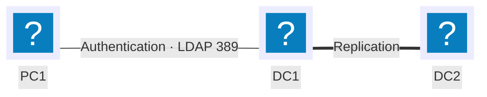

---
tags:
  - Authentication
  - Privilege management
---

# Active Directory

## Context

Centralizing identification and authentication for a Windows fleet in a single directory, instead of a local account base per machine (the "workgroup" model, SAM database). An Active Directory domain groups users, groups and computers into a tree of organizational units (OUs), applies security policies through GPOs, and replicates the directory across several domain controllers to keep it available.

This page builds a minimal tree — one OU, one account, one group — applying the **AGDLP** method Microsoft recommends for assigning rights, then a GPO linked to that OU.

## Prerequisites

- A Windows Server promoted to domain controller (AD DS role installed), here `DC1` on the `galaxy-swiss.com` domain
- The `ActiveDirectory` PowerShell module (RSAT) available on the admin workstation
- A client machine joined to the domain, to check that GPOs actually apply
- The reference addressing plan from the [conventions](../conventions.md)

!!! note "Reference points: DN, GUID and group scopes"
    Every object is identified by its **DistinguishedName** (`cn=Pierre,ou=Informatique,dc=galaxy-swiss,dc=com` — the LDAP path inside the directory, which changes if the object is moved) and its **GUID** (a 128-bit identifier, assigned at creation, never changed). A group has a **scope** — domain local, global or universal — that determines where it can be used; that's what structures the AGDLP method below.

## Topology



`DC1` and `DC2` each hold a copy of the directory and replicate with each other: the domain's availability no longer depends on a single server. PC1, joined to the domain, authenticates against whichever domain controller is available.

## Procedure

### 1. Create the organizational unit

```powershell
New-ADOrganizationalUnit -Name "Comptabilite" -Path "DC=galaxy-swiss,DC=com" -ProtectedFromAccidentalDeletion $true
```

!!! tip "`-ProtectedFromAccidentalDeletion` is on by default in the GUI, not in PowerShell"
    An OU created from the graphical console is protected against accidental deletion; in PowerShell this isn't automatic without this explicit parameter. This protection will need to be lifted before the OU can be removed — see the rollback plan.

### 2. Create a user account

```powershell
New-ADUser -Name "Jean Dupont" -GivenName "Jean" -Surname "Dupont" `
  -SamAccountName "jdupont" -UserPrincipalName "jdupont@galaxy-swiss.com" `
  -Path "OU=Comptabilite,DC=galaxy-swiss,DC=com" `
  -AccountPassword (Read-Host -AsSecureString "Initial password") `
  -ChangePasswordAtLogon $true -Enabled $true
```

!!! warning "A PowerShell-created account is disabled by default"
    Without `-Enabled $true`, the account exists in the directory but can't authenticate — unlike an account created from the `dsa.msc` console. This is the most common reason a freshly created user can't log on.

### 3. Create the groups following the AGDLP method

A **global** group represents the job function, a **domain local** group represents access to a resource; permissions are never granted directly to a user or to a global group.

```powershell
New-ADGroup -Name "GG_Comptables" -GroupScope Global -GroupCategory Security `
  -Path "OU=Comptabilite,DC=galaxy-swiss,DC=com"

New-ADGroup -Name "GDL_Partage_Compta_Lecture" -GroupScope DomainLocal -GroupCategory Security `
  -Path "OU=Comptabilite,DC=galaxy-swiss,DC=com"

Add-ADGroupMember -Identity "GG_Comptables" -Members "jdupont"
Add-ADGroupMember -Identity "GDL_Partage_Compta_Lecture" -Members "GG_Comptables"
```

!!! note "Account → Global Group → Domain Local Group → Permissions"
    `jdupont` joins `GG_Comptables` (their job function), which in turn joins `GDL_Partage_Compta_Lecture` (access to the resource). If `jdupont` changes department, only their global group membership needs to change — the permissions set on the resource never need touching.

### 4. Grant NTFS permissions to the domain local group

Permissions are set only on the domain local group, never on the global group or on the user.

```powershell
icacls "D:\Partages\Compta" /grant "GALAXY-SWISS\GDL_Partage_Compta_Lecture:(RX)"
```

### 5. Create a GPO and link it to the organizational unit

```powershell
New-GPO -Name "GPO_Compta_Ecran" | New-GPLink -Target "OU=Comptabilite,DC=galaxy-swiss,DC=com"
```

The GPO's actual settings (enforced wallpaper, lock timeout, etc.) are then configured from the `gpmc.msc` console, under `User Configuration` or `Computer Configuration` depending on the target.

!!! note "Application order: LSDOU"
    A GPO applies in the order **L**ocal, **S**ite, **D**omain, **O**rganizational **U**nit. When two GPOs set contradictory values, the last one applied — so the one closest to the object, usually the OU — wins.

### 6. Force the update on the client and check

```powershell
gpupdate /force
gpresult /r
```

## Rollback plan

```powershell
Get-GPO -Name "GPO_Compta_Ecran" | Remove-GPLink -Target "OU=Comptabilite,DC=galaxy-swiss,DC=com"
Remove-GPO -Name "GPO_Compta_Ecran"

Remove-ADGroupMember -Identity "GDL_Partage_Compta_Lecture" -Members "GG_Comptables" -Confirm:$false
Remove-ADGroup -Identity "GDL_Partage_Compta_Lecture" -Confirm:$false
Remove-ADGroup -Identity "GG_Comptables" -Confirm:$false

Remove-ADUser -Identity "jdupont" -Confirm:$false

Set-ADOrganizationalUnit -Identity "OU=Comptabilite,DC=galaxy-swiss,DC=com" -ProtectedFromAccidentalDeletion $false
Remove-ADOrganizationalUnit -Identity "OU=Comptabilite,DC=galaxy-swiss,DC=com" -Confirm:$false
```

!!! warning "Lift the protection before removing the OU"
    `Remove-ADOrganizationalUnit` fails while `ProtectedFromAccidentalDeletion` is `$true` — on purpose. Turning the protection off is a separate, deliberate step, never a side effect of removal.

Remove the GPO first, then the group memberships, then the groups, then the user, and the OU last — in that order, so no object is ever left orphaned while something else still references it.

## Verification

```powershell
Get-ADUser -Filter {SamAccountName -eq "jdupont"} -Properties MemberOf
Get-ADGroupMember -Identity "GDL_Partage_Compta_Lecture"
gpresult /r /scope user
```

`gpresult /r` lists the GPOs actually applied to the current user and computer — proof that a GPO linked to the OU really made it down to the workstation, not just that it exists in the directory.

To confirm both domain controllers hold the same directory:

```powershell
repadmin /replsummary
```

Expected result: a `Largest Delta` close to zero and no replication errors listed for `DC1` or `DC2`.

## Troubleshooting

| Symptom | Likely cause | Fix |
|---|---|---|
| The new user can't log on | Account created without `-Enabled $true` | `Enable-ADAccount -Identity "jdupont"` |
| A user still reaches a resource after leaving the department | Still a member of the associated `GG_...` global group | Remove them from the global group; never touch the NTFS permissions |
| The GPO doesn't seem applied on the workstation | Refresh interval (60–120 min) hasn't elapsed yet | `gpupdate /force` on the client |
| Two GPOs produce a contradictory result | LSDOU order — the one closest to the object wins | Check the link order in `gpmc.msc` or with `gpresult /r` |
| `Remove-ADOrganizationalUnit` fails with "access denied" | `ProtectedFromAccidentalDeletion` still on | `Set-ADOrganizationalUnit -ProtectedFromAccidentalDeletion $false` before retrying |
| `repadmin /replsummary` reports an error between DC1 and DC2 | Replication failure (network, DNS, stopped service) | `repadmin /showrepl` on each domain controller to isolate the cause |

!!! note "LDAP protocol"
    A domain controller exposes the directory over LDAP, on port **389** in the clear or **636** for LDAPS (encrypted). That's the same protocol a third-party application (GLPI, a firewall, a VPN) uses to authenticate its users against the directory instead of maintaining its own account base.
