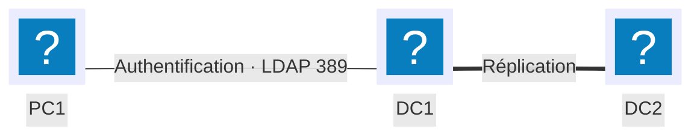

# Active Directory

## Contexte

Centraliser l'identification et l'authentification d'un parc Windows dans un annuaire unique, plutôt qu'une base de comptes locale par machine (modèle « groupe de travail », base SAM). Un domaine Active Directory regroupe utilisateurs, groupes et ordinateurs dans une arborescence d'unités d'organisation (OU), applique des stratégies de sécurité via des GPO, et réplique l'annuaire entre plusieurs contrôleurs de domaine pour assurer sa disponibilité.

Cette fiche construit une arborescence minimale — une OU, un compte, un groupe — en appliquant la méthode **AGDLP** recommandée par Microsoft pour l'attribution des droits, puis une GPO liée à cette OU.

## Prérequis

- Un serveur Windows Server promu contrôleur de domaine (rôle AD DS installé), ici `DC1` sur le domaine `galaxy-swiss.com`
- Le module PowerShell `ActiveDirectory` (RSAT) disponible sur le poste d'administration
- Un poste client joint au domaine pour vérifier l'application des GPO
- Le plan d'adressage de référence des [conventions](../conventions.md)

!!! note "Repères : DN, GUID et étendues de groupe"
    Chaque objet est identifié par son **DistinguishedName** (`cn=Pierre,ou=Informatique,dc=galaxy-swiss,dc=com` — le chemin LDAP dans l'annuaire, qui change si l'objet est déplacé) et son **GUID** (identifiant sur 128 bits, attribué à la création, invariable). Un groupe a une **étendue** — domaine local, globale ou universelle — qui détermine où il peut être utilisé ; c'est elle qui structure la méthode AGDLP ci-dessous.

## Topologie



`DC1` et `DC2` hébergent chacun une copie de l'annuaire et se répliquent entre eux : la disponibilité du domaine ne dépend alors plus d'un seul serveur. PC1, joint au domaine, s'authentifie auprès du contrôleur de domaine le plus disponible.

## Procédure

### 1. Créer l'unité d'organisation

```powershell
New-ADOrganizationalUnit -Name "Comptabilite" -Path "DC=galaxy-swiss,DC=com" -ProtectedFromAccidentalDeletion $true
```

!!! tip "`-ProtectedFromAccidentalDeletion` est activé par défaut"
    Une OU créée depuis la console graphique est protégée contre la suppression accidentelle ; en PowerShell, ce n'est pas automatique sans ce paramètre explicite. Cette protection devra être levée avant de pouvoir supprimer l'OU — voir le plan de retour arrière.

### 2. Créer un compte utilisateur

```powershell
New-ADUser -Name "Jean Dupont" -GivenName "Jean" -Surname "Dupont" `
  -SamAccountName "jdupont" -UserPrincipalName "jdupont@galaxy-swiss.com" `
  -Path "OU=Comptabilite,DC=galaxy-swiss,DC=com" `
  -AccountPassword (Read-Host -AsSecureString "Mot de passe initial") `
  -ChangePasswordAtLogon $true -Enabled $true
```

!!! warning "Un compte créé en PowerShell est désactivé par défaut"
    Sans `-Enabled $true`, le compte existe dans l'annuaire mais ne peut pas s'authentifier — contrairement à un compte créé depuis la console `dsa.msc`. C'est la cause la plus fréquente d'un utilisateur fraîchement créé qui ne peut pas ouvrir de session.

### 3. Créer les groupes selon la méthode AGDLP

Un groupe **global** représente la fonction métier, un groupe de **domaine local** représente l'accès à une ressource ; les permissions ne sont jamais attribuées directement à un utilisateur ni à un groupe global.

```powershell
New-ADGroup -Name "GG_Comptables" -GroupScope Global -GroupCategory Security `
  -Path "OU=Comptabilite,DC=galaxy-swiss,DC=com"

New-ADGroup -Name "GDL_Partage_Compta_Lecture" -GroupScope DomainLocal -GroupCategory Security `
  -Path "OU=Comptabilite,DC=galaxy-swiss,DC=com"

Add-ADGroupMember -Identity "GG_Comptables" -Members "jdupont"
Add-ADGroupMember -Identity "GDL_Partage_Compta_Lecture" -Members "GG_Comptables"
```

!!! note "Account → Global Group → Domain Local Group → Permissions"
    `jdupont` entre dans `GG_Comptables` (sa fonction), qui entre à son tour dans `GDL_Partage_Compta_Lecture` (l'accès à la ressource). Si `jdupont` change de service, il suffit de le changer de groupe global — jamais besoin de retoucher les permissions posées sur la ressource.

### 4. Attribuer les permissions NTFS au groupe de domaine local

Les permissions se posent uniquement sur le groupe de domaine local, jamais sur le groupe global ni sur l'utilisateur.

```powershell
icacls "D:\Partages\Compta" /grant "GALAXY-SWISS\GDL_Partage_Compta_Lecture:(RX)"
```

### 5. Créer et lier une GPO à l'unité d'organisation

```powershell
New-GPO -Name "GPO_Compta_Ecran" | New-GPLink -Target "OU=Comptabilite,DC=galaxy-swiss,DC=com"
```

Les paramètres de la GPO (fond d'écran imposé, délai de verrouillage, etc.) se configurent ensuite depuis la console `gpmc.msc`, sous `Configuration utilisateur` ou `Configuration ordinateur` selon la cible.

!!! note "Ordre d'application : LSDOU"
    Une GPO s'applique dans l'ordre **L**ocal, **S**ite Active Directory, **D**omaine, **U**nité d'organisation. En cas de paramètres contradictoires entre deux GPO, c'est la dernière appliquée — donc la plus proche de l'objet, en général l'UO — qui l'emporte.

### 6. Forcer l'application sur le poste client et vérifier

```powershell
gpupdate /force
gpresult /r
```

## Plan de retour arrière

```powershell
Get-GPO -Name "GPO_Compta_Ecran" | Remove-GPLink -Target "OU=Comptabilite,DC=galaxy-swiss,DC=com"
Remove-GPO -Name "GPO_Compta_Ecran"

Remove-ADGroupMember -Identity "GDL_Partage_Compta_Lecture" -Members "GG_Comptables" -Confirm:$false
Remove-ADGroup -Identity "GDL_Partage_Compta_Lecture" -Confirm:$false
Remove-ADGroup -Identity "GG_Comptables" -Confirm:$false

Remove-ADUser -Identity "jdupont" -Confirm:$false

Set-ADOrganizationalUnit -Identity "OU=Comptabilite,DC=galaxy-swiss,DC=com" -ProtectedFromAccidentalDeletion $false
Remove-ADOrganizationalUnit -Identity "OU=Comptabilite,DC=galaxy-swiss,DC=com" -Confirm:$false
```

!!! warning "Retirer la protection avant de supprimer l'OU"
    `Remove-ADOrganizationalUnit` échoue tant que `ProtectedFromAccidentalDeletion` vaut `$true` — c'est volontaire. Désactiver la protection est une étape distincte, jamais un effet de bord du retrait.

Retirer d'abord la GPO, puis les appartenances de groupe, puis les groupes, puis l'utilisateur, et l'OU en dernier — dans cet ordre, pour ne jamais laisser un objet orphelin référencé ailleurs.

## Vérification

```powershell
Get-ADUser -Filter {SamAccountName -eq "jdupont"} -Properties MemberOf
Get-ADGroupMember -Identity "GDL_Partage_Compta_Lecture"
gpresult /r /scope user
```

`gpresult /r` liste les GPO réellement appliquées à l'utilisateur et à l'ordinateur en cours — c'est la preuve qu'une GPO liée à l'OU est bien descendue jusqu'au poste, pas seulement qu'elle existe dans l'annuaire.

Pour confirmer que les deux contrôleurs de domaine partagent le même annuaire :

```powershell
repadmin /replsummary
```

Résultat attendu : `Largest Delta` proche de zéro et aucune erreur de réplication listée pour `DC1` et `DC2`.

## Dépannage

| Symptôme | Cause probable | Correction |
|---|---|---|
| Le nouvel utilisateur ne peut pas ouvrir de session | Compte créé sans `-Enabled $true` | `Enable-ADAccount -Identity "jdupont"` |
| L'utilisateur accède à la ressource bien qu'il ait quitté le service | Toujours membre du groupe global `GG_...` associé | Le retirer du groupe global ; jamais besoin de toucher aux permissions NTFS |
| La GPO n'apparaît pas appliquée sur le poste | Intervalle d'actualisation (60–120 min) pas encore écoulé | `gpupdate /force` sur le poste client |
| Deux GPO produisent un résultat contradictoire | Ordre LSDOU — la plus proche de l'objet l'emporte | Vérifier l'ordre de liaison dans `gpmc.msc` ou avec `gpresult /r` |
| `Remove-ADOrganizationalUnit` échoue avec « accès refusé » | `ProtectedFromAccidentalDeletion` toujours activé | `Set-ADOrganizationalUnit -ProtectedFromAccidentalDeletion $false` avant de retenter |
| `repadmin /replsummary` signale une erreur entre DC1 et DC2 | Réplication en échec (réseau, DNS, service arrêté) | `repadmin /showrepl` sur chacun des deux contrôleurs pour isoler la cause |

!!! note "Protocole LDAP"
    Un contrôleur de domaine expose l'annuaire via LDAP, sur le port **389** en clair ou **636** en LDAPS (chiffré). C'est ce même protocole qu'utilise une application tierce (GLPI, un pare-feu, un VPN) pour authentifier ses utilisateurs contre l'annuaire plutôt que de maintenir sa propre base de comptes.
