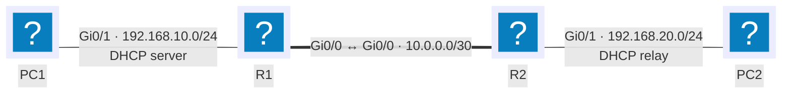

---
tags:
  - Default route
---

# DHCP

## Context

Automatically assigning IP address, mask, gateway, and other network parameters to client machines, instead of configuring them one by one. Essential as soon as a fleet grows past a handful of machines, or hosts mobile users.

## Prerequisites

- A Cisco IOS router with the LAN interface already statically addressed (it serves as the gateway)
- Routing already working between the subnets involved — see [Static routing](routage-statique.md)
- The reference addressing plan from the [conventions](../conventions.md)

## Topology



R1 hosts the DHCP service for both subnets. PC1, on the same link, reaches R1 directly by broadcast. PC2, behind R2, needs a relay agent (step 5) since broadcasts don't cross a router.

## Procedure

### 1. Exclude statically assigned addresses

Addresses already used by fixed devices (gateways, servers, printers) must never be offered by DHCP.

```cisco
enable
configure terminal
ip dhcp excluded-address 192.168.10.1 192.168.10.10
ip dhcp excluded-address 192.168.20.1 192.168.20.10
```

!!! warning "Declare before the pool"
    An exclusion doesn't revoke leases already handed out in the range: it only affects future assignments. Declaring it before creating the pool avoids an address being handed out in between.

### 2. Create the pool for the users LAN

One pool per subnet: address range, gateway, DNS, lease duration.

```cisco
ip dhcp pool LAN-UTILISATEURS
 network 192.168.10.0 255.255.255.0
 default-router 192.168.10.1
 dns-server 8.8.8.8
 domain-name exemple.local
 lease 7
```

`default-router` and `dns-server` are options attached to this pool: only clients on this subnet receive them. `lease 7` sets the lease to 7 days; the default is one day.

### 3. Create the pool for the servers LAN

```cisco
ip dhcp pool LAN-SERVEURS
 network 192.168.20.0 255.255.255.0
 default-router 192.168.20.1
 dns-server 8.8.8.8
 domain-name exemple.local
 lease 7
```

!!! note "No overlap between pools"
    Two pools — even on different DHCP servers — must never cover the same address range: two separate clients could end up with the same address.

### 4. Reserve an address for a specific host

So a server or printer always gets the same address while still being managed from the DHCP pool, instead of static addressing on the host itself.

```cisco
ip dhcp pool SRV1-RESA
 host 192.168.20.50 255.255.255.0
 client-identifier 0100.1234.5678.90
```

A Windows host's `client-identifier` is `01` followed by its MAC address; for a Linux client or a device that sends its hardware address directly, `hardware-address` replaces `client-identifier`.

### 5. Relay requests to the remote subnet

R2 doesn't host a DHCP service: it must forward PC2's broadcasts to R1 as unicast.

```cisco
interface GigabitEthernet0/1
 ip helper-address 192.168.10.1
```

!!! tip "`ip helper-address` relays more than DHCP"
    By default, the command also forwards TFTP, DNS, NetBIOS and a few other broadcast protocols. To relay DHCP only, restrict with `no ip forward-protocol udp <port>` on the services not wanted.

### 6. Save

```cisco
end
copy running-config startup-config
```

## Linux equivalent (isc-dhcp-server)

```text
# /etc/dhcp/dhcpd.conf
subnet 192.168.10.0 netmask 255.255.255.0 {
    range 192.168.10.11 192.168.10.200;
    option routers 192.168.10.1;
    option domain-name-servers 8.8.8.8;
    default-lease-time 604800;
    max-lease-time 604800;
}

host srv1 {
    hardware ethernet 00:11:22:33:44:55;
    fixed-address 192.168.20.50;
}
```

```bash
sudo systemctl restart isc-dhcp-server
```

!!! note "Listening interface"
    `isc-dhcp-server` needs to be told which interface to listen on (`INTERFACESv4="ens18"` in `/etc/default/isc-dhcp-server`), otherwise the service starts without answering any request.

## Rollback plan

```cisco
configure terminal
interface GigabitEthernet0/1
 no ip helper-address 192.168.10.1
exit
no ip dhcp pool SRV1-RESA
no ip dhcp pool LAN-SERVEURS
no ip dhcp pool LAN-UTILISATEURS
no ip dhcp excluded-address 192.168.10.1 192.168.10.10
no ip dhcp excluded-address 192.168.20.1 192.168.20.10
end
copy running-config startup-config
```

!!! warning "Active leases aren't revoked"
    Removing a pool doesn't interrupt leases already handed out: affected hosts keep their address until it expires or `ipconfig /release` is run. To clear the lease database immediately: `clear ip dhcp binding *`.

## Verification

=== "On the router"

    ```cisco
    show ip dhcp binding
    show ip dhcp pool
    show ip dhcp conflict
    ```

    `show ip dhcp binding` lists active leases with the client's MAC address and expiry date. `show ip dhcp conflict` flags addresses the server detected as already in use on the network before assigning them.

=== "From a Windows host"

    ```powershell
    ipconfig /all
    ipconfig /release
    ipconfig /renew
    ```

=== "From a Linux host"

    ```bash
    ip addr show
    sudo dhclient -r
    sudo dhclient -v
    ```

Expected result: the host gets an address within its subnet's range, with the right gateway and DNS servers — to compare against `show ip dhcp binding` on the server side.

## Troubleshooting

| Symptom | Likely cause | Fix |
|---|---|---|
| The host gets a `169.254.x.x` address (APIPA) | No DHCP response received | Check the pool is active and, if the client is on another subnet, that `ip helper-address` is configured |
| The host gets an address from the wrong subnet | Overlapping pools across two DHCP servers | Compare ranges with `show ip dhcp pool` on each server |
| A printer or server changes address after a reboot | No reservation, or a forgotten exclusion | Add a `host` reservation or fix `ip dhcp excluded-address` |
| `show ip dhcp conflict` lists an address | A device is statically addressed inside the dynamic range | Exclude the address or move it out of the static range |
| PC2 never gets a lease even though R1 works | `ip helper-address` missing or misplaced | Configure it on R2's interface that receives PC2's broadcasts, not on R1's |

!!! note "Authorizing the server in Active Directory"
    In a Windows Server environment with Active Directory, a DHCP server must be authorized by a member of the Enterprise Admins group before it will answer clients. This protects against a rogue DHCP server handing out conflicting addresses.
