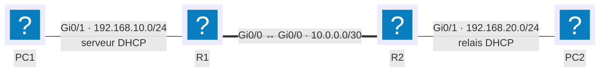

# DHCP

## Contexte

Attribuer automatiquement l'adresse IP, le masque, la passerelle et les autres paramètres réseau aux postes clients, sans les configurer un par un. Indispensable dès qu'un parc dépasse quelques machines ou qu'il accueille des utilisateurs mobiles.

## Prérequis

- Un routeur Cisco IOS avec l'interface LAN déjà adressée en statique (elle sert de passerelle)
- Le routage déjà fonctionnel entre les sous-réseaux concernés — voir [Routage statique](routage-statique.md)
- Le plan d'adressage de référence des [conventions](../conventions.md)

## Topologie



R1 héberge le service DHCP pour les deux sous-réseaux. PC1, sur le même lien, atteint directement R1 par diffusion. PC2, derrière R2, a besoin d'un agent relais (étape 5) puisque les diffusions ne traversent pas un routeur.

## Procédure

### 1. Exclure les adresses attribuées en statique

Les adresses déjà utilisées par des équipements fixes (passerelles, serveurs, imprimantes) ne doivent jamais être proposées par le DHCP.

```cisco
enable
configure terminal
ip dhcp excluded-address 192.168.10.1 192.168.10.10
ip dhcp excluded-address 192.168.20.1 192.168.20.10
```

!!! warning "À déclarer avant l'étendue"
    Une exclusion ne retire pas les baux déjà distribués dans la plage : elle n'agit que sur les attributions futures. La déclarer avant de créer l'étendue évite qu'une adresse statique soit distribuée entre-temps.

### 2. Créer l'étendue du LAN utilisateurs

Une étendue par sous-réseau : plage d'adresses, passerelle, DNS, durée du bail.

```cisco
ip dhcp pool LAN-UTILISATEURS
 network 192.168.10.0 255.255.255.0
 default-router 192.168.10.1
 dns-server 8.8.8.8
 domain-name exemple.local
 lease 7
```

`default-router` et `dns-server` sont des options affectées à cette étendue : seuls les clients de ce sous-réseau les reçoivent. `lease 7` fixe le bail à 7 jours ; par défaut il est d'un jour.

### 3. Créer l'étendue du LAN serveurs

```cisco
ip dhcp pool LAN-SERVEURS
 network 192.168.20.0 255.255.255.0
 default-router 192.168.20.1
 dns-server 8.8.8.8
 domain-name exemple.local
 lease 7
```

!!! note "Pas de chevauchement entre étendues"
    Deux étendues — même sur des serveurs DHCP différents — ne doivent jamais couvrir la même plage d'adresses : deux clients distincts recevraient potentiellement la même adresse.

### 4. Réserver une adresse pour un hôte précis

Pour qu'un serveur ou une imprimante reçoive toujours la même adresse tout en restant géré depuis l'étendue DHCP, plutôt qu'en adressage statique sur le poste.

```cisco
ip dhcp pool SRV1-RESA
 host 192.168.20.50 255.255.255.0
 client-identifier 0100.1234.5678.90
```

Le `client-identifier` d'un hôte Windows correspond à `01` suivi de son adresse MAC ; pour un client Linux ou un équipement qui envoie directement son adresse matérielle, `hardware-address` remplace `client-identifier`.

### 5. Relayer les requêtes vers le sous-réseau distant

R2 n'héberge pas de service DHCP : il doit transmettre les diffusions de PC2 vers R1 en unicast.

```cisco
interface GigabitEthernet0/1
 ip helper-address 192.168.10.1
```

!!! tip "`ip helper-address` relaie plus que le DHCP"
    Par défaut, la commande transfère aussi les requêtes TFTP, DNS, NetBIOS et quelques autres protocoles de diffusion. Pour ne relayer que le DHCP, restreindre avec `no ip forward-protocol udp <port>` sur les services non souhaités.

### 6. Enregistrer

```cisco
end
copy running-config startup-config
```

## Équivalent Linux (isc-dhcp-server)

```text
# /etc/dhcp/dhcpd.conf
subnet 192.168.10.0 netmask 255.255.255.0 {
    range 192.168.10.11 192.168.10.200;
    option routers 192.168.10.1;
    option domain-name-servers 8.8.8.8;
    default-lease-time 604800;
    max-lease-time 604800;
}

host srv1 {
    hardware ethernet 00:11:22:33:44:55;
    fixed-address 192.168.20.50;
}
```

```bash
sudo systemctl restart isc-dhcp-server
```

!!! note "Interface d'écoute"
    `isc-dhcp-server` doit être configuré avec l'interface sur laquelle il écoute (`INTERFACESv4="ens18"` dans `/etc/default/isc-dhcp-server`), faute de quoi le service démarre sans répondre à aucune requête.

## Plan de retour arrière

```cisco
configure terminal
interface GigabitEthernet0/1
 no ip helper-address 192.168.10.1
exit
no ip dhcp pool SRV1-RESA
no ip dhcp pool LAN-SERVEURS
no ip dhcp pool LAN-UTILISATEURS
no ip dhcp excluded-address 192.168.10.1 192.168.10.10
no ip dhcp excluded-address 192.168.20.1 192.168.20.10
end
copy running-config startup-config
```

!!! warning "Les baux en cours ne sont pas révoqués"
    Supprimer une étendue n'interrompt pas les baux déjà distribués : les postes concernés gardent leur adresse jusqu'à expiration ou `ipconfig /release`. Pour vider la base de baux immédiatement : `clear ip dhcp binding *`.

## Vérification

=== "Sur le routeur"

    ```cisco
    show ip dhcp binding
    show ip dhcp pool
    show ip dhcp conflict
    ```

    `show ip dhcp binding` liste les baux actifs avec l'adresse MAC du client et la date d'expiration. `show ip dhcp conflict` signale les adresses que le serveur a détectées comme déjà utilisées sur le réseau avant de les attribuer.

=== "Depuis un poste Windows"

    ```powershell
    ipconfig /all
    ipconfig /release
    ipconfig /renew
    ```

=== "Depuis un poste Linux"

    ```bash
    ip addr show
    sudo dhclient -r
    sudo dhclient -v
    ```

Résultat attendu : le poste obtient une adresse dans la plage de son sous-réseau, avec la bonne passerelle et les bons DNS — à comparer avec `show ip dhcp binding` côté serveur.

## Dépannage

| Symptôme | Cause probable | Correction |
|---|---|---|
| Le poste reçoit une adresse `169.254.x.x` (APIPA) | Aucune réponse DHCP reçue | Vérifier que l'étendue est active et, si le client est sur un autre sous-réseau, que `ip helper-address` est configuré |
| Le poste reçoit une adresse d'un mauvais sous-réseau | Étendues chevauchantes entre deux serveurs DHCP | Comparer les plages avec `show ip dhcp pool` sur chaque serveur |
| Une imprimante ou un serveur change d'adresse après redémarrage | Pas de réservation, ou exclusion oubliée | Ajouter une réservation `host` ou corriger `ip dhcp excluded-address` |
| `show ip dhcp conflict` liste une adresse | Équipement adressé en statique dans la plage dynamique | Exclure l'adresse ou la sortir de la plage statique |
| PC2 ne reçoit jamais de bail alors que R1 fonctionne | `ip helper-address` absent ou mal placé | Le configurer sur l'interface de R2 qui reçoit les diffusions de PC2, pas sur celle de R1 |

!!! note "Autoriser le serveur dans Active Directory"
    En environnement Windows Server avec Active Directory, un serveur DHCP doit être autorisé (« authorized ») par un membre du groupe Administrateurs de l'entreprise avant de répondre aux clients. C'est une protection contre un serveur DHCP non maîtrisé qui distribuerait des adresses en conflit.
