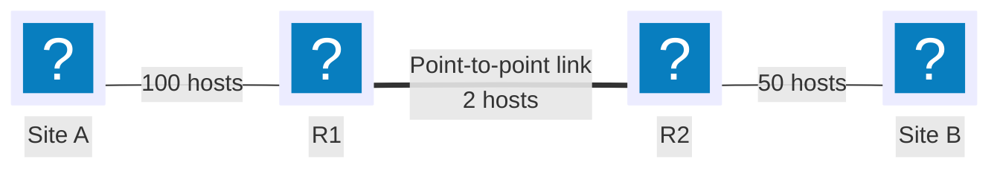

---
tags:
  - Filtering
---

# VLSM Subnetting

## Context

A "flat" network — every host in a single subnet — propagates broadcasts (ARP, DHCP) to every machine, regardless of its role or location, and puts every incident within reach of everything else. Splitting it into several subnets shrinks each broadcast domain, limits what a compromised host can reach directly, and allows different filtering rules per segment (see [Cisco ACL](cisco-acl.md)).

**VLSM** (Variable Length Subnet Mask) means splitting a single address block into subnets of different sizes, each sized as closely as possible to the number of hosts actually needed — as opposed to splitting into equal-sized blocks, which wastes addresses on small segments to accommodate the largest one.

## Prerequisites

- The address block allocated for the split, and each segment's host-count requirement
- Subnet mask and CIDR notation from the [conventions](../conventions.md)
- Routing already planned between the segments — see [Static routing](../reseau/routage-statique.md)

## Calculation method

| Step | Calculation |
|---|---|
| Usable hosts for *h* host bits | `2^h - 2` (network and broadcast addresses excluded) |
| Number of subnets for *s* borrowed bits | `2^s` |
| Minimal mask for *N* hosts | The smallest `/n` such that `2^(32-n) - 2 ≥ N` |

!!! warning "Always allocate largest need first"
    VLSM requires an order: handle host requirements from largest to smallest, and carve each subnet right after the previous one in the available block. Allocating a small subnet first can fragment the remaining space to the point where a larger requirement no longer fits afterward, even if the total number of free addresses would have been enough.

## Topology



Block allocated for this whole inter-network: `192.168.1.0/24` (254 usable host addresses in total).

## Procedure

### 1. List requirements and sort them in descending order

| Segment | Hosts needed |
|---|---|
| Site A LAN | 100 |
| Site B LAN | 50 |
| R1↔R2 link | 2 |

### 2. Calculate the minimal mask for the first requirement (100 hosts)

```text
2^7 - 2 = 126 ≥ 100   → 7 host bits are enough
32 - 7 = /25
```

First subnet, carved from the start of the available block: `192.168.1.0/25` (126 usable hosts).

### 3. Calculate the mask for the second requirement (50 hosts)

```text
2^6 - 2 = 62 ≥ 50   → 6 host bits are enough
32 - 6 = /26
```

Second subnet, carved right after the first: `192.168.1.128/26` (62 usable hosts).

### 4. Calculate the mask for the third requirement (2 hosts, point-to-point link)

```text
2^2 - 2 = 2 ≥ 2   → 2 host bits are enough
32 - 2 = /30
```

Third subnet, carved after the second: `192.168.1.192/30` (2 usable hosts).

!!! note "Resulting addressing plan"
    | Subnet | Prefix | First host address | Last host address | Broadcast |
    |---|---|---|---|---|
    | Site A LAN | `192.168.1.0/25` | `192.168.1.1` | `192.168.1.126` | `192.168.1.127` |
    | Site B LAN | `192.168.1.128/26` | `192.168.1.129` | `192.168.1.190` | `192.168.1.191` |
    | R1↔R2 link | `192.168.1.192/30` | `192.168.1.193` | `192.168.1.194` | `192.168.1.195` |

    `192.168.1.196` through `192.168.1.255` (60 addresses) remain unallocated in the original block — a reserve for future growth, not space that needs filling right away.

### 5. Configure the interfaces on R1

```cisco
enable
configure terminal
interface GigabitEthernet0/1
 description Site A LAN
 ip address 192.168.1.1 255.255.255.128
 no shutdown
exit
interface Serial0/0/0
 description Link to R2
 ip address 192.168.1.193 255.255.255.252
 no shutdown
exit
```

### 6. Configure the interfaces on R2

```cisco
enable
configure terminal
interface GigabitEthernet0/1
 description Site B LAN
 ip address 192.168.1.129 255.255.255.192
 no shutdown
exit
interface Serial0/0/0
 description Link to R1
 ip address 192.168.1.194 255.255.255.252
 no shutdown
exit
```

### 7. Route between the segments and save

```cisco
ip route 192.168.1.128 255.255.255.192 192.168.1.194
end
copy running-config startup-config
```

On R2, the symmetric route to the Site A LAN: `ip route 192.168.1.0 255.255.255.128 192.168.1.193`. Full method in [Static routing](../reseau/routage-statique.md).

## Rollback plan

```cisco
configure terminal
no ip route 192.168.1.128 255.255.255.192 192.168.1.194
interface GigabitEthernet0/1
 no ip address
exit
interface Serial0/0/0
 no ip address
exit
end
copy running-config startup-config
```

Do the same on R2 for its route and interfaces. Remove the routes first, then the interface addresses — a route pointing to a next hop that just lost its address would stay invalid until cleanup is complete, without making the command itself fail.

## Verification

```cisco
show ip interface brief
show ip route
ping 192.168.1.129 source 192.168.1.1
```

`show ip interface brief` should show every interface with its address and `up/up` status. An address that spills outside its intended subnet (for example `192.168.1.130` mistakenly assigned to the Site A interface instead of Site B's) signals a mix-up between two blocks calculated in steps 2–4 — catch it before going live, not after.

## Troubleshooting

| Symptom | Likely cause | Fix |
|---|---|---|
| Two subnets partially overlap | The next prefix was calculated from the wrong starting address | Restart from the previous subnet's broadcast address + 1, not a rounded value |
| A subnet meant to hold *N* hosts holds fewer than expected | Forgot to subtract the network and broadcast addresses (`2^h - 2`, not `2^h`) | Recheck the formula at the step where the mask was chosen |
| The last subnet won't fit even though enough total addresses remain | Requirements handled in the wrong order (small before large) | Start over from the original block and reallocate largest requirement first |
| A host can't reach the gateway | Interface address outside the subnet's valid range (network or broadcast address used by mistake) | Compare the configured address against the range calculated in steps 2–4 |
| No room left for a future subnet | No reserve left after allocating the initial requirements | Size the overall block with margin, or revisit the addressing plan upstream |
