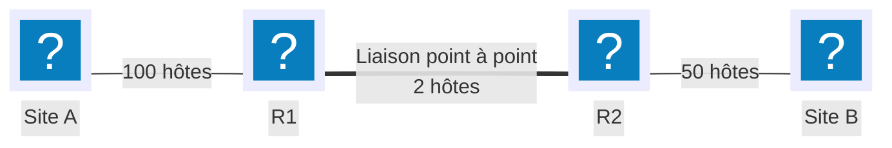

# Segmentation VLSM

## Contexte

Un réseau « à plat » — tous les hôtes dans un seul sous-réseau — propage les diffusions (ARP, DHCP) à toutes les machines, quelle que soit leur fonction ou leur localisation, et place tout incident sur une machine à portée de tout le reste. Segmenter en plusieurs sous-réseaux réduit le domaine de diffusion de chacun, limite ce qu'un hôte compromis peut atteindre directement, et permet d'appliquer des règles de filtrage différentes par segment (voir [ACL Cisco](cisco-acl.md)).

**VLSM** (Variable Length Subnet Mask) consiste à découper un même bloc d'adresses en sous-réseaux de tailles différentes, chacun dimensionné au plus près du nombre d'hôtes réellement nécessaire — par opposition à un découpage en blocs de taille identique, qui gaspille des adresses sur les petits segments pour satisfaire les plus grands.

## Prérequis

- Le bloc d'adresses alloué à segmenter, et le besoin en nombre d'hôtes de chaque segment
- Les notions de masque de sous-réseau et de notation CIDR des [conventions](../conventions.md)
- Le routage déjà planifié entre les segments — voir [Routage statique](../reseau/routage-statique.md)

## Méthode de calcul

| Étape | Calcul |
|---|---|
| Hôtes utilisables pour *h* bits de partie hôte | `2^h - 2` (adresse réseau et diffusion exclues) |
| Nombre de sous-réseaux pour *s* bits empruntés | `2^s` |
| Masque minimal pour *N* hôtes | Le plus petit `/n` tel que `2^(32-n) - 2 ≥ N` |

!!! warning "Toujours allouer du plus grand besoin au plus petit"
    VLSM impose un ordre : traiter les besoins en hôtes du plus grand au plus petit, et prélever chaque sous-réseau immédiatement après le précédent dans le bloc disponible. Attribuer un petit sous-réseau en premier peut fragmenter l'espace restant au point de ne plus pouvoir caser un besoin plus grand ensuite, même si le nombre total d'adresses libres suffirait.

## Topologie



Bloc alloué pour l'ensemble de cet inter-réseau : `192.168.1.0/24` (254 adresses d'hôte disponibles au total).

## Procédure

### 1. Lister les besoins et les trier par ordre décroissant

| Segment | Hôtes nécessaires |
|---|---|
| LAN Site A | 100 |
| LAN Site B | 50 |
| Liaison R1↔R2 | 2 |

### 2. Calculer le masque minimal pour le premier besoin (100 hôtes)

```text
2^7 - 2 = 126 ≥ 100   → 7 bits d'hôte suffisent
32 - 7 = /25
```

Premier sous-réseau, prélevé en tête du bloc disponible : `192.168.1.0/25` (126 hôtes utilisables).

### 3. Calculer le masque pour le deuxième besoin (50 hôtes)

```text
2^6 - 2 = 62 ≥ 50   → 6 bits d'hôte suffisent
32 - 6 = /26
```

Deuxième sous-réseau, prélevé juste après le premier : `192.168.1.128/26` (62 hôtes utilisables).

### 4. Calculer le masque pour le troisième besoin (2 hôtes, liaison point à point)

```text
2^2 - 2 = 2 ≥ 2   → 2 bits d'hôte suffisent
32 - 2 = /30
```

Troisième sous-réseau, prélevé après le deuxième : `192.168.1.192/30` (2 hôtes utilisables).

!!! note "Plan d'adressage obtenu"
    | Sous-réseau | Préfixe | Première adresse d'hôte | Dernière adresse d'hôte | Diffusion |
    |---|---|---|---|---|
    | LAN Site A | `192.168.1.0/25` | `192.168.1.1` | `192.168.1.126` | `192.168.1.127` |
    | LAN Site B | `192.168.1.128/26` | `192.168.1.129` | `192.168.1.190` | `192.168.1.191` |
    | Liaison R1↔R2 | `192.168.1.192/30` | `192.168.1.193` | `192.168.1.194` | `192.168.1.195` |

    Il reste `192.168.1.196` à `192.168.1.255` (60 adresses) non attribuées dans le bloc d'origine — une réserve pour une évolution future, plutôt qu'un espace à combler immédiatement.

### 5. Configurer les interfaces sur R1

```cisco
enable
configure terminal
interface GigabitEthernet0/1
 description LAN Site A
 ip address 192.168.1.1 255.255.255.128
 no shutdown
exit
interface Serial0/0/0
 description Liaison vers R2
 ip address 192.168.1.193 255.255.255.252
 no shutdown
exit
```

### 6. Configurer les interfaces sur R2

```cisco
enable
configure terminal
interface GigabitEthernet0/1
 description LAN Site B
 ip address 192.168.1.129 255.255.255.192
 no shutdown
exit
interface Serial0/0/0
 description Liaison vers R1
 ip address 192.168.1.194 255.255.255.252
 no shutdown
exit
```

### 7. Router entre les segments et enregistrer

```cisco
ip route 192.168.1.128 255.255.255.192 192.168.1.194
end
copy running-config startup-config
```

Sur R2, la route symétrique vers le LAN Site A : `ip route 192.168.1.0 255.255.255.128 192.168.1.193`. Détail de la méthode dans [Routage statique](../reseau/routage-statique.md).

## Plan de retour arrière

```cisco
configure terminal
no ip route 192.168.1.128 255.255.255.192 192.168.1.194
interface GigabitEthernet0/1
 no ip address
exit
interface Serial0/0/0
 no ip address
exit
end
copy running-config startup-config
```

Faire la même chose sur R2 pour sa route et ses interfaces. Retirer d'abord les routes, puis les adresses d'interface — une route pointant vers un prochain saut qui vient de perdre son adresse resterait invalide jusqu'au nettoyage complet, sans faire échouer la commande elle-même.

## Vérification

```cisco
show ip interface brief
show ip route
ping 192.168.1.129 source 192.168.1.1
```

`show ip interface brief` doit afficher chaque interface avec son adresse et le statut `up/up`. Une adresse qui déborde du sous-réseau prévu (par exemple `192.168.1.130` attribuée par erreur à l'interface du Site A plutôt qu'à celle du Site B) est le signe d'une confusion entre deux blocs calculés à l'étape 2-4 — à repérer avant la mise en service, pas après.

## Dépannage

| Symptôme | Cause probable | Correction |
|---|---|---|
| Deux sous-réseaux se chevauchent partiellement | Calcul du préfixe suivant fait depuis la mauvaise adresse de départ | Reprendre l'adresse de diffusion du sous-réseau précédent + 1, pas une valeur arrondie |
| Un sous-réseau censé contenir *N* hôtes en contient moins que prévu | Oubli de soustraire l'adresse réseau et l'adresse de diffusion (`2^h - 2`, pas `2^h`) | Revérifier la formule à l'étape où le masque a été choisi |
| Impossible de caser le dernier sous-réseau alors qu'il reste assez d'adresses au total | Besoins traités dans le mauvais ordre (petit avant grand) | Repartir du bloc d'origine et réallouer du plus grand besoin au plus petit |
| Un hôte ne peut pas joindre la passerelle | Adresse d'interface hors de la plage valide du sous-réseau (adresse réseau ou diffusion utilisée par erreur) | Comparer l'adresse configurée à la plage calculée à l'étape 2-4 |
| Le futur sous-réseau à ajouter ne trouve plus de place libre | Aucune réserve laissée après l'allocation des besoins initiaux | Dimensionner le bloc global avec une marge, ou revoir le plan d'adressage en amont |
