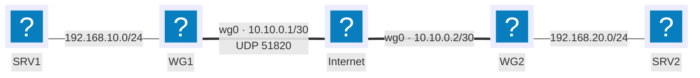

---
tags:
  - Encryption
  - Authentication
---

# VPN (WireGuard)

## Context

A VPN (Virtual Private Network) links two points across a network that isn't under your control — usually the Internet — by simulating a direct private link. Two common uses:

- **Remote access**: a single workstation (telework, travel) joins the company network as if it were physically plugged in.
- **Site-to-site** (Intranet VPN between two sites of the same company, or Extranet VPN with a partner): two gateways permanently connect two remote private networks.

Without a VPN, a host outside the local network is treated by the company's resources like any other host on the Internet: no access to files, business applications or internal services that aren't explicitly published.

A VPN tunnel must guarantee: **authentication** of both endpoints (so a third party can't impersonate either side), **confidentiality** of the content (encryption), and its **integrity** (detecting any tampering in transit). This page uses WireGuard rather than IPsec or OpenVPN: configuration reduced to a handful of parameters, modern cryptography enforced by default (no cipher-suite negotiation), and operating as a standard network interface (`wg0`) rather than a separate application daemon.

## Prerequisites

- Two Linux machines (both sites' gateways, or a server plus a roaming workstation) with `wireguard-tools` installed
- A public IP address reachable over UDP on at least one of the two points (the tunnel's "server")
- IP forwarding (`ip_forward`) enabled on the gateways for a site-to-site tunnel
- The reference addressing plan from the [conventions](../conventions.md); this page adds a subnet dedicated to the tunnel: `10.10.0.0/30`

## Topology



`WG1` has a fixed public address and acts as the tunnel's server; `WG2` initiates it as a client. Both gateways carry a second `wg0` interface, on a subnet dedicated to the tunnel, separate from the LANs they connect.

## Procedure

### 1. Install WireGuard

```bash
sudo apt update
sudo apt install wireguard
```

### 2. Generate a key pair on each gateway

```bash
wg genkey | sudo tee /etc/wireguard/privatekey | wg pubkey | sudo tee /etc/wireguard/publickey
sudo chmod 600 /etc/wireguard/privatekey
```

!!! warning "The private key never leaves its own machine"
    Only the **public** key is shared with the other gateway (over a trusted channel, outside the tunnel since it doesn't exist yet). Handing over a private key is the same as handing over the full identity of the endpoint it authenticates.

### 3. Configure the interface on WG1 (server)

```text
# /etc/wireguard/wg0.conf — WG1
[Interface]
PrivateKey = <WG1's private key>
Address = 10.10.0.1/30
ListenPort = 51820

[Peer]
PublicKey = <WG2's public key>
AllowedIPs = 10.10.0.2/32, 192.168.20.0/24
```

`AllowedIPs` serves two purposes at once: filtering which packets are accepted from this peer, and acting as the route to the remote network once the interface is up.

### 4. Configure the interface on WG2 (client)

```text
# /etc/wireguard/wg0.conf — WG2
[Interface]
PrivateKey = <WG2's private key>
Address = 10.10.0.2/30

[Peer]
PublicKey = <WG1's public key>
Endpoint = 203.0.113.2:51820
AllowedIPs = 10.10.0.1/32, 192.168.10.0/24
PersistentKeepalive = 25
```

!!! tip "`PersistentKeepalive` on the client side only"
    If WG2 sits behind NAT (consumer ADSL/fiber, no fixed public IP), this parameter sends an empty packet every 25 seconds to keep the NAT mapping open. Unnecessary on WG1, which has a stable, directly reachable public address.

### 5. Enable IP forwarding and bring the tunnel up

```bash
sudo sysctl -w net.ipv4.ip_forward=1
echo "net.ipv4.ip_forward=1" | sudo tee /etc/sysctl.d/99-wireguard.conf
sudo systemctl enable --now wg-quick@wg0
```

### 6. Variant: remote access for a roaming workstation

A roaming workstation is configured as an additional peer on WG1, with a route limited to itself rather than to an entire subnet.

=== "Server side (WG1): add the peer"

    ```text
    [Peer]
    PublicKey = <roaming workstation's public key>
    AllowedIPs = 10.10.0.3/32
    ```

    ```bash
    sudo wg syncconf wg0 <(wg-quick strip wg0)
    ```

    `wg syncconf` reloads the configuration without dropping tunnels already established with other peers — unlike `wg-quick down` followed by `up`.

=== "Roaming workstation side"

    ```text
    [Interface]
    PrivateKey = <workstation's private key>
    Address = 10.10.0.3/32
    DNS = 192.168.10.53

    [Peer]
    PublicKey = <WG1's public key>
    Endpoint = 203.0.113.2:51820
    AllowedIPs = 192.168.10.0/24
    PersistentKeepalive = 25
    ```

    `AllowedIPs = 192.168.10.0/24` restricts the tunnel to traffic bound for the company LAN (split tunnel): the rest of the workstation's Internet traffic keeps going out directly, without passing through the tunnel.

!!! note "Full tunnel vs. split tunnel"
    Replacing `AllowedIPs` with `0.0.0.0/0` routes all of the roaming workstation's traffic through the VPN, including ordinary web browsing — useful for inspecting that traffic from the company side, but it eats into the VPN's bandwidth and slows down anything unrelated to work.

## Rollback plan

```bash
sudo systemctl disable --now wg-quick@wg0
sudo rm /etc/wireguard/wg0.conf
```

To remove only one peer (for example a roaming workstation that should no longer access the network) without tearing down the rest of the tunnel:

```bash
sudo wg set wg0 peer <peer's public key> remove
```

!!! warning "Revoke a compromised key everywhere, not just here"
    Removing a peer on WG1 stops it from joining this tunnel, but its private key stays valid if it was copied elsewhere. If a key is suspected compromised, generate a fresh key pair on the machine concerned rather than just removing the old public key.

## Verification

```bash
sudo wg show
ping -c 4 10.10.0.2
ping -c 4 192.168.20.10
```

`wg show` displays, for each peer, the time of the last handshake (`latest handshake`) and the data transferred. An entry with no `latest handshake` means the tunnel never managed to establish.

To confirm the traffic that actually crosses the Internet is encrypted, capture on the physical interface rather than on `wg0`:

```bash
sudo tcpdump -n -i eth0 udp port 51820
```

The application content (an HTML page, a login) never shows up in the clear there — only encrypted UDP packets to port 51820 are visible, whatever protocol is carried inside the tunnel.

## Troubleshooting

| Symptom | Likely cause | Fix |
|---|---|---|
| `wg show` shows no `latest handshake` | UDP port 51820 blocked by a firewall, or wrong public key | Check the port is open on the server side and that both sides' public keys match |
| Handshake established but no ping gets through | `AllowedIPs` doesn't cover the remote network, or `ip_forward` disabled | Check `AllowedIPs` on both peers and `sysctl net.ipv4.ip_forward` |
| The tunnel works, then drops after a few minutes | A peer behind NAT, with no `PersistentKeepalive` | Add `PersistentKeepalive = 25` on the peer behind NAT |
| The roaming workstation reaches the LAN but loses normal Internet access | `AllowedIPs = 0.0.0.0/0` when a split tunnel was intended | Restrict `AllowedIPs` to the company subnet only |
| A removed workstation can still connect | Public key removed server-side, but the service wasn't reloaded | `wg syncconf` or `systemctl restart wg-quick@wg0` after editing the config file |

!!! danger "Exposed private key"
    If a private key is compromised (stolen device, leaked config file), the exposure window lasts until the matching peer is removed *and* the corresponding entry disappears from the other endpoint's configuration. Treat this as a security incident, not a routine cleanup task.
