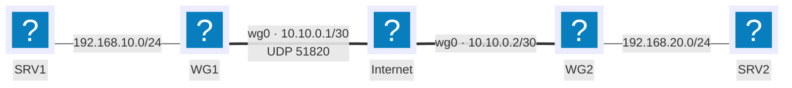

# VPN (WireGuard)

## Contexte

Un VPN (Virtual Private Network) relie deux points à travers un réseau non maîtrisé — le plus souvent Internet — en simulant une liaison privée directe. Deux usages courants :

- **Accès distant** : un poste unique (télétravail, déplacement) rejoint le réseau de l'entreprise comme s'il y était physiquement branché.
- **Site à site** (Intranet VPN entre deux sites d'une même entreprise, ou Extranet VPN avec un partenaire) : deux passerelles relient en permanence deux réseaux privés distants.

Sans VPN, un poste en dehors du réseau local est traité comme n'importe quel hôte d'Internet par les ressources de l'entreprise : aucun accès aux fichiers, applications métier ou services internes qui ne sont pas explicitement publiés.

Un tunnel VPN doit garantir : une **authentification** des deux extrémités (éviter qu'un tiers ne se fasse passer pour l'un des points), la **confidentialité** du contenu (chiffrement), et son **intégrité** (détecter toute altération en transit). Cette fiche utilise WireGuard plutôt qu'IPsec ou OpenVPN : configuration réduite à une poignée de paramètres, cryptographie moderne imposée par défaut (pas de négociation de suite d'algorithmes), et fonctionnement en interface réseau standard (`wg0`) plutôt qu'en démon applicatif séparé.

## Prérequis

- Deux machines Linux (passerelles des deux sites, ou serveur + poste nomade) avec `wireguard-tools` installé
- Une adresse IP publique joignable en UDP sur au moins l'un des deux points (le « serveur » du tunnel)
- Le transfert IP (`ip_forward`) activé sur les passerelles pour un tunnel site à site
- Le plan d'adressage de référence des [conventions](../conventions.md) ; cette fiche ajoute un sous-réseau dédié au tunnel : `10.10.0.0/30`

## Topologie



`WG1` dispose d'une adresse publique fixe et joue le rôle de serveur du tunnel ; `WG2` l'initie en tant que client. Les deux passerelles portent une seconde interface `wg0`, sur un sous-réseau dédié au tunnel, séparé des LAN qu'elles relient.

## Procédure

### 1. Installer WireGuard

```bash
sudo apt update
sudo apt install wireguard
```

### 2. Générer une paire de clés sur chaque passerelle

```bash
wg genkey | sudo tee /etc/wireguard/privatekey | wg pubkey | sudo tee /etc/wireguard/publickey
sudo chmod 600 /etc/wireguard/privatekey
```

!!! warning "La clé privée ne quitte jamais sa machine"
    Seule la clé **publique** se communique à l'autre passerelle (par un canal de confiance, hors tunnel puisqu'il n'existe pas encore). Transmettre une clé privée équivaut à donner l'identité complète du point qu'elle authentifie.

### 3. Configurer l'interface côté WG1 (serveur)

```text
# /etc/wireguard/wg0.conf — WG1
[Interface]
PrivateKey = <clé privée de WG1>
Address = 10.10.0.1/30
ListenPort = 51820

[Peer]
PublicKey = <clé publique de WG2>
AllowedIPs = 10.10.0.2/32, 192.168.20.0/24
```

`AllowedIPs` sert une double fonction : filtrer les paquets acceptés depuis ce pair, et servir de route vers le réseau distant une fois l'interface active.

### 4. Configurer l'interface côté WG2 (client)

```text
# /etc/wireguard/wg0.conf — WG2
[Interface]
PrivateKey = <clé privée de WG2>
Address = 10.10.0.2/30

[Peer]
PublicKey = <clé publique de WG1>
Endpoint = 203.0.113.2:51820
AllowedIPs = 10.10.0.1/32, 192.168.10.0/24
PersistentKeepalive = 25
```

!!! tip "`PersistentKeepalive` côté client uniquement"
    Si WG2 est derrière un NAT (ADSL/fibre grand public, pas d'IP publique fixe), ce paramètre envoie un paquet vide toutes les 25 secondes pour maintenir l'association NAT ouverte. Inutile côté WG1, qui possède une adresse publique stable et joignable directement.

### 5. Activer le transfert IP et le tunnel

```bash
sudo sysctl -w net.ipv4.ip_forward=1
echo "net.ipv4.ip_forward=1" | sudo tee /etc/sysctl.d/99-wireguard.conf
sudo systemctl enable --now wg-quick@wg0
```

### 6. Variante : accès distant pour un poste nomade

Un poste nomade se configure comme un pair supplémentaire sur WG1, avec une route limitée à lui-même plutôt qu'à un sous-réseau entier.

=== "Côté serveur (WG1) : ajouter le pair"

    ```text
    [Peer]
    PublicKey = <clé publique du poste nomade>
    AllowedIPs = 10.10.0.3/32
    ```

    ```bash
    sudo wg syncconf wg0 <(wg-quick strip wg0)
    ```

    `wg syncconf` recharge la configuration sans couper les tunnels déjà établis avec les autres pairs — contrairement à `wg-quick down` puis `up`.

=== "Côté poste nomade"

    ```text
    [Interface]
    PrivateKey = <clé privée du poste>
    Address = 10.10.0.3/32
    DNS = 192.168.10.53

    [Peer]
    PublicKey = <clé publique de WG1>
    Endpoint = 203.0.113.2:51820
    AllowedIPs = 192.168.10.0/24
    PersistentKeepalive = 25
    ```

    `AllowedIPs = 192.168.10.0/24` limite le tunnel au trafic vers le LAN de l'entreprise (split tunnel) : le reste du trafic Internet du poste continue de sortir directement, sans passer par le tunnel.

!!! note "Tunnel complet ou partagé"
    Remplacer `AllowedIPs` par `0.0.0.0/0` route tout le trafic du poste nomade à travers le VPN, y compris sa navigation Internet ordinaire — utile pour inspecter ce trafic depuis l'entreprise, mais cela consomme sa bande passante VPN et ralentit tout usage non lié au travail.

## Plan de retour arrière

```bash
sudo systemctl disable --now wg-quick@wg0
sudo rm /etc/wireguard/wg0.conf
```

Pour retirer uniquement un pair (par exemple un poste nomade qui ne doit plus accéder au réseau) sans couper le reste du tunnel :

```bash
sudo wg set wg0 peer <clé publique du pair> remove
```

!!! warning "Révoquer une clé compromise ailleurs aussi"
    Supprimer un pair sur WG1 l'empêche de rejoindre ce tunnel, mais sa clé privée reste valide si elle a été copiée ailleurs. En cas de compromission suspectée, régénérer une nouvelle paire de clés sur la machine concernée plutôt que de se contenter de retirer l'ancienne clé publique.

## Vérification

```bash
sudo wg show
ping -c 4 10.10.0.2
ping -c 4 192.168.20.10
```

`wg show` affiche, pour chaque pair, l'heure de la dernière poignée de main (`latest handshake`) et le volume transféré. Une entrée sans `latest handshake` indique un tunnel qui n'a jamais réussi à s'établir.

Pour constater que le trafic qui transite réellement par Internet est chiffré, capturer sur l'interface physique plutôt que sur `wg0` :

```bash
sudo tcpdump -n -i eth0 udp port 51820
```

Le contenu applicatif (une page HTML, une authentification) n'y apparaît jamais en clair — seuls des paquets UDP chiffrés vers le port 51820 sont visibles, quel que soit le protocole transporté dans le tunnel.

## Dépannage

| Symptôme | Cause probable | Correction |
|---|---|---|
| `wg show` n'affiche aucun `latest handshake` | Port UDP 51820 bloqué par un pare-feu, ou mauvaise clé publique | Vérifier l'ouverture du port côté serveur et comparer les clés publiques des deux côtés |
| Handshake établi mais aucun ping ne passe | `AllowedIPs` ne couvre pas le réseau distant, ou `ip_forward` désactivé | Vérifier `AllowedIPs` sur les deux pairs et `sysctl net.ipv4.ip_forward` |
| Le tunnel fonctionne puis se coupe après quelques minutes | Pair derrière un NAT, sans `PersistentKeepalive` | Ajouter `PersistentKeepalive = 25` côté pair derrière le NAT |
| Le poste nomade accède au LAN mais perd tout accès Internet normal | `AllowedIPs = 0.0.0.0/0` alors qu'un tunnel partagé était prévu | Restreindre `AllowedIPs` au seul sous-réseau de l'entreprise |
| Un ancien poste supprimé se connecte encore | Clé publique retirée côté serveur, mais service non rechargé | `wg syncconf` ou `systemctl restart wg-quick@wg0` après modification du fichier |

!!! danger "Clé privée exposée"
    Si une clé privée est compromise (poste volé, fichier de configuration divulgué), la fenêtre d'exposition dure jusqu'à ce que le pair correspondant soit retiré *et* que l'entrée associée disparaisse de la configuration de l'autre extrémité. Traiter ce cas comme un incident de sécurité, pas comme une simple tâche de ménage.
